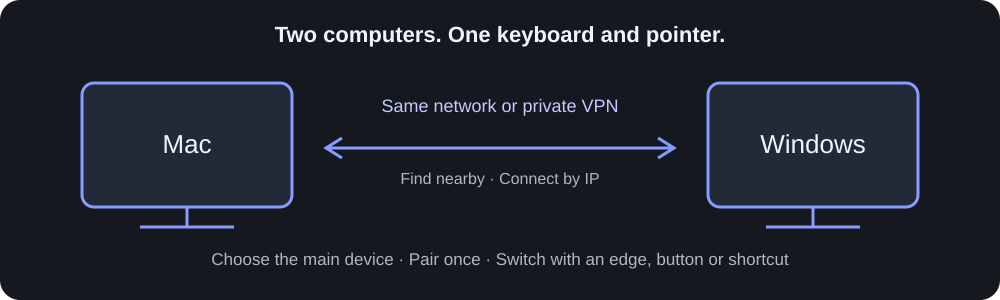
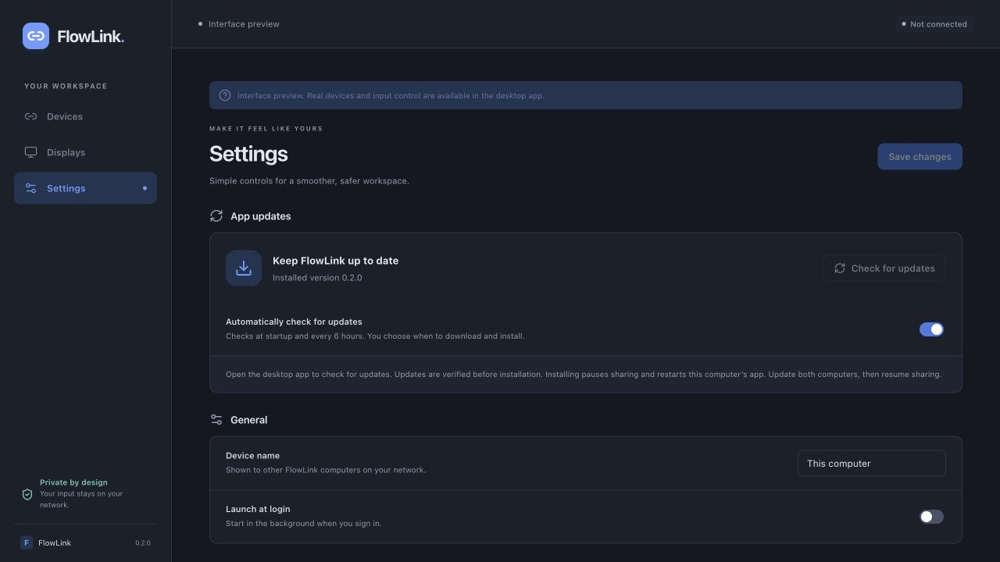

# FlowLink

**Share one keyboard and pointer between your Mac and Windows PC.**

FlowLink connects two computers over the same network or a reachable private VPN address. Use your Mac to control Windows, or your Windows PC to control your Mac. Pair the computers, choose the main device, and switch using a screen edge, button, or keyboard shortcut. No account or cloud server is required.



> **Development preview · version 0.2.0**
>
> Features below are implemented, with automated regression coverage. Real Mac ↔ Windows input, touchpad feel, and Kerio VPN reliability still need testing on physical devices. Use matching **0.2** builds on both computers; **0.1 is incompatible**. No new release has been published.

[Features](#features) · [Setup](#connect-your-computers) · [Shortcuts](#keyboard-and-touchpad) · [Installers](#installers) · [Development](#development)

## Features

| Feature                      | What you can do                                                                                                                                                      |
| ---------------------------- | -------------------------------------------------------------------------------------------------------------------------------------------------------------------- |
| **Mac ↔ Windows control**    | Share keyboard, mouse, and ordinary touchpad input in either direction.                                                                                              |
| **Main-device selection**    | Choose which computer supplies input. Allow either device to change the main device, or restrict changes to the current main device. Both can still release control. |
| **Nearby or IP connection**  | Discover nearby computers or enter a private IP/hostname, with an optional port.                                                                                     |
| **Remembered pairing**       | Reconnect to a trusted computer without pairing again. Reconnection does not automatically take control.                                                             |
| **Screen arrangement**       | Position one controlled screen beside the main computer’s display group and switch at a shared edge.                                                                 |
| **Editable shortcuts**       | Create separate Mac → Windows and Windows → Mac rules, use Ctrl ↔ Command editing presets, or forward physical keys.                                                 |
| **Pointer and scrolling**    | Adjust pointer speed and scroll direction; forward horizontal/vertical scrolling and small touchpad movements.                                                       |
| **Pause and recovery**       | Pause sharing, return input locally, and release held input when a connection stalls. Pause survives app restarts.                                                   |
| **Update controls**          | Check for updates, enable background checks, download a verified update, and choose when to install and restart.                                                     |
| **Menu-bar / tray controls** | Connect, pause, release control, and open settings without keeping the main window open.                                                                             |

## App preview



_Actual Settings screen from the browser interface preview. Device connection and update actions require the native desktop app._

## Connect your computers

1. **Open matching FlowLink 0.2 builds on both computers.** On Mac, grant **Accessibility / Device Control** and **Input Monitoring**, allow Local Network access if prompted, then restart FlowLink.
2. **Connect.** Select the other computer under **Nearby**, or click **Connect by IP** and enter the address shown on that computer.
3. **Pair.** Approve the request on the receiving computer, then enter its six-digit code on the initiating computer. FlowLink remembers the pairing.
4. **Choose the main device.** In **Devices → Main device**, select the computer whose keyboard and pointer you want to use. Choose whether either computer may change this selection.
5. **Arrange your screens.** On the main device, open **Displays**, select the controlled screen, position it beside your display group, and save.
6. **Start controlling.** Move across the configured edge or click **Control other computer**.

**To return immediately:** press **Ctrl + Alt + Shift + Escape**. On Mac, Alt is **Option**. This pauses sharing locally. Settings also offers F12 instead of Escape.

Closing the window keeps FlowLink running in the menu bar or tray. Choose **Quit** to exit.

### Same network or VPN

Start with **Automatic** network interface selection. For a VPN such as Kerio, enter the other computer’s reachable private IP if it does not appear under Nearby.

FlowLink uses **TCP port 47831** by default. Working RDP confirms that an RDP route is available; FlowLink’s own port must also be permitted by your firewall/VPN policy. FlowLink does not change these policies.

After a network interruption, a trusted connection can reconnect automatically. Resume control explicitly once the connection is responsive. Clicking **Disconnect** stops automatic reconnect until you connect manually or restart the app.

## Keyboard and touchpad

### Everyday shortcuts

Enable **Adapt editing shortcuts** to translate supported Windows Ctrl editing combinations to Mac Command combinations, and the reverse. Mac terminal exceptions preserve Control; Ctrl+Alt/AltGr combinations are not treated as ordinary Ctrl editing shortcuts.

For your own mappings, open **Settings → Custom shortcuts**:

1. Choose **Mac → Windows** or **Windows → Mac**.
2. Enter a source and target, such as `Cmd+Shift+C` → `Ctrl+Shift+C`.
3. Add or update the rule, then click **Save changes**.

Configure shortcuts on the computer supplying input. Each computer keeps its own preferences. Switch and emergency shortcuts are reserved.

| Action                             | Default shortcut        |
| ---------------------------------- | ----------------------- |
| Switch / release control           | `Ctrl+Alt+Shift+Right`  |
| Emergency pause and return locally | `Ctrl+Alt+Shift+Escape` |

When receiving input, the switch shortcut releases control. When local on the other computer, it can make that computer main if the policy allows; starting remote control is a separate action. Release shortcut keys before handoff.

The receiving computer’s keyboard layout determines typing. FlowLink does not synchronize language state. English/Russian layouts and IME workflows still need physical testing.

### Touchpad support

Pointer movement, clicks, horizontal/vertical scrolling, fractional deltas, and Mac scroll momentum deltas are supported. Pointer speed and reverse scrolling are configurable. Windows uses the pointer/wheel events exposed by the OS. **Pinch, rotate, and three-finger gestures are not forwarded.**

## Installers

| Platform                       | Current status                                                                                           |
| ------------------------------ | -------------------------------------------------------------------------------------------------------- |
| **macOS 13+ · Apple Silicon**  | Local 0.2.0 DMG built and verified. No public download published.                                        |
| **Windows 11 · Intel/AMD x64** | NSIS installer configuration exists. Building and testing the current Windows installer remains pending. |
| **Intel Mac**                  | Build configuration exists; not yet verified on hardware.                                                |

### Install a Mac test build

Quit any running FlowLink, open the DMG, and drag **FlowLink → Applications**. Open it from Applications, grant the permissions described above, then restart it.

Local builds use ad-hoc signing and are not Apple-notarized. If macOS blocks your trusted test build, use **System Settings → Privacy & Security → Open Anyway** for that app.

### Build installers locally

After installing the [development prerequisites](#development), run on the corresponding OS:

```sh
# Mac: app and drag-to-Applications installer
npm run desktop:build -- --bundles app,dmg

# Windows: setup executable
npm run desktop:build -- --bundles nsis
```

Outputs are under `target/release/bundle/`: `dmg/` and `macos/` on Mac, `nsis/` on Windows. Windows test builds may show an unknown-publisher notice and may need internet access to install WebView2.

The [Check workflow](.github/workflows/check.yml) can produce Windows test artifacts. Always check the source revision and app version; an older successful workflow run may contain incompatible 0.1 code.

### Updates and release preparation

**Settings → App updates** includes **Check for updates**, optional automatic checks, download progress, release notes, and **Install & restart**. Automatic checks do not automatically download or install. Installing pauses sharing and releases input before restarting. Update both computers, then resume sharing.

The update mechanism is configured, but no new update was published. Checks may report unavailable until a valid update feed exists.

The manual [Prepare installers workflow](.github/workflows/prepare-release.yml) prepares Mac and Windows artifacts without publishing a release. Production signing credentials and device testing are still required. See [update and signing setup](docs/UPDATES.md).

## Current limits

- One connected peer at a time. All native displays on the main computer are supported, with one selected controlled display for edge switching.
- No Linux, clipboard/file transfer, USB-specific networking, macros, or shortcut recording.
- Login/FileVault screens, Windows UAC/secure desktops, protected input, media keys, and all keyboard/IME combinations are unsupported or unverified.
- Automated tests cover ownership changes, recovery, shortcuts, fractional scrolling, and connection fallback. They do not prove real-device latency, pointer feel, or VPN reliability.

See [testing and device checks](docs/TESTING.md) and the [roadmap](docs/ROADMAP.md).

## Privacy and connection security

Pairing uses a short-lived code with attempt limits. Trusted sessions use mutually authenticated TLS 1.3 with pinned device identities. Private identity material uses OS credential storage; secrets are excluded from frontend state and settings exports. Diagnostics are opt-in and redacted.

There is no account, cloud relay, or analytics service. The pairing and input-control design still needs a focused security review before public release. See [security notes](docs/SECURITY.md) and the [protocol](docs/PROTOCOL.md).

## Development

Built with **Rust, Tauri 2, React 19, and TypeScript**.

### Prerequisites

- Node.js **22.12+** and npm.
- Rust installed through rustup; use the pinned [toolchain](rust-toolchain.toml).
- macOS: Xcode Command Line Tools.
- Windows: Microsoft C++ Build Tools with **Desktop development with C++**, a Windows SDK, Rust’s MSVC toolchain, and Microsoft Edge WebView2 Runtime.

See [Tauri’s native prerequisites](https://v2.tauri.app/start/prerequisites/) for platform setup. Restart your terminal after installing build tools.

```sh
git clone https://github.com/aagzamov-dev/FlowLink.git
cd FlowLink
npm ci
npm run desktop
```

For interface-only development, use `npm run dev` and open `http://127.0.0.1:1420`. The browser preview does not share input or connect real devices.

### Checks

```sh
npm run typecheck
npm run lint
npm test
npm run build
cargo fmt --all --check
cargo clippy --workspace --all-targets -- -D warnings
cargo test --workspace
```

`cargo run -p flowlink-engine --example inspect` reports native display/network inventory and permission readiness without installing input hooks or injecting events.

The desktop launcher uses an ignored project-local Rust installation in `.tools/` when present. Do not copy `.tools/`, `node_modules/`, or `target/` between operating systems.

| Folder                    | Contents                                                         |
| ------------------------- | ---------------------------------------------------------------- |
| `crates/flowlink-engine/` | Input, connections, pairing, recovery, and platform integrations |
| `src-tauri/`              | Native app, tray controls, updates, and packaging                |
| `src/`                    | React and TypeScript interface                                   |
| `docs/`                   | Architecture, protocol, testing, and release preparation         |

[Architecture](docs/ARCHITECTURE.md) · [Protocol](docs/PROTOCOL.md) · [Security](docs/SECURITY.md) · [Testing](docs/TESTING.md) · [Roadmap](docs/ROADMAP.md)

## Contributing

Include your OS version, hardware, network setup, and reproduction steps with bug reports. Remove pairing codes, private keys, and other sensitive data. Distinguish physical-device observations from automated test results.

## License

[MIT](LICENSE).
